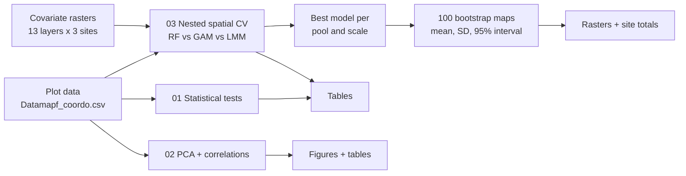

# Carbon stock modelling and mapping in Malagasy open ecosystems

[](LICENSE)


R code accompanying the paper **"Towards a better understanding of spatial carbon storage in open ecosystem areas of Madagascar"** (Ramifehiarivo *et al.*).

The study quantifies and maps carbon stocks (Mg C ha⁻¹) across five pools (aboveground biomass, belowground biomass, deadwood, litter and soil organic carbon at 0–30 and 0–100 cm) in three contrasting Malagasy open-ecosystem sites, using **307 field plots** sampled in 2024:

| Site | Code | Climate / setting | Plots |
|---|---|---|---|
| Ankarafantsika | AF | Dry lowland, north-west | 107 |
| Ambohitantely | AT | Subhumid highland, centre | 111 |
| Ivohiboro | IV | Subhumid lowland, south-east | 89 |

This repository contains the **statistical, multivariate and spatial-modelling parts** of the analysis. It is a subset of the paper's full workflow (field inventories, allometry and soil laboratory work are not included).

## What is in here

| Step | Script | What it does |
|---|---|---|
| 0 | [`scripts/00_install_packages.R`](scripts/00_install_packages.R) | Installs the required R packages |
| 1 | [`scripts/01_statistical_tests.R`](scripts/01_statistical_tests.R) | Assumption checks (Shapiro–Wilk, Levene), choice between ANOVA / Welch ANOVA / Kruskal–Wallis (raw or log(1+x)), post-hoc tests (Tukey, Games–Howell, Dunn–Holm), effect sizes and descriptive statistics of carbon pools by land cover and site |
| 2 | [`scripts/02_pca_correlation.R`](scripts/02_pca_correlation.R) | PCA of environmental covariates and of carbon pools (with supplementary variables), marginal PERMANOVA, rank-based VIF, Spearman correlation matrices (BH-adjusted), scree and contribution plots |
| 3 | [`scripts/03_nested_spatial_RF_GAM_LMM_manuscript_v4.qmd`](scripts/03_nested_spatial_RF_GAM_LMM_manuscript_v4.qmd) | Full modelling framework: variogram diagnostics, site-specific spatial blocking, **nested spatial block cross-validation (10 outer / 5 inner folds)** of Random Forest, GAM and LMM, model comparison, variable importance and partial dependence, and **100 bootstrap maps** with per-pixel uncertainty and site totals (Tg C) |
| – | [`python/`](python) | Optional Python / Kaggle re-implementation of step 3 (see [`python/README.md`](python/README.md)) |



### Modelling design (step 3)

- **Scales:** all sites combined (ALL) and each site separately (AF, AT, IV).
- **Pools:** SOC 0–30, SOC 0–100, AGC, BGC, deadwood, litter, total C.
- **Covariates:** 13 (10 continuous topographic and climatic layers + land cover, fire frequency and soil type), extracted from 30 m rasters.
- **Spatial blocks:** one block design per site chosen by matching test-to-train distances with map-prediction distances (never on model scores). ALL is the union of the site folds, so all scales are evaluated on the same test plots.
- **Variable selection** runs inside the outer training sets only (VSURF for RF, forward CV selection for GAM, forward AIC for LMM).
- **Evaluation:** R², RMSE, nRMSE, MAE and RPD per outer fold; paired Wilcoxon tests with Holm correction; best model = lowest mean MAE and RMSE.
- **Uncertainty:** within-block bootstrap (B = 100) of the best model.

The Quarto document explains every setting and equation reference in detail.

## Getting started

### Requirements

- R ≥ 4.3 and [Quarto](https://quarto.org/docs/get-started/) ≥ 1.4 (for step 3)
- The packages listed in [`scripts/00_install_packages.R`](scripts/00_install_packages.R)
- Step 3 takes **many hours** for the full run (every stage is cached and resumable). A quick test run is available with `MADA_FAST=1`.

### Data

Data are **not included**. They are available from the authors on request, and the expected structure is documented in [`data/README.md`](data/README.md).

### Run

```r
# 1. Install packages (once)
source("scripts/00_install_packages.R")

# 2. Place Datamapf_coordo.csv and covariates_30m/ in data/ (see data/README.md)

# 3. Run the analyses from the project root (the .here file marks it)
source("scripts/01_statistical_tests.R")   # -> outputs/stat_tests/
source("scripts/02_pca_correlation.R")     # -> outputs/pca/
```

```bash
# Modelling and maps (long run). Quick smoke test first:
MADA_FAST=1 quarto render scripts/03_nested_spatial_RF_GAM_LMM_manuscript_v4.qmd

# Full run
quarto render scripts/03_nested_spatial_RF_GAM_LMM_manuscript_v4.qmd

# Data stored elsewhere
MADA_BASE=/path/to/data quarto render scripts/03_nested_spatial_RF_GAM_LMM_manuscript_v4.qmd
```

All outputs are written to `outputs/` (git-ignored): figures (PNG at 600 dpi and PDF), tables (CSV, XLSX, DOCX), bootstrap map rasters and cached model objects.

## Repository structure

```
.
├── scripts/
│   ├── 00_install_packages.R
│   ├── 01_statistical_tests.R
│   ├── 02_pca_correlation.R
│   └── 03_nested_spatial_RF_GAM_LMM_manuscript_v4.qmd
├── python/                  # optional Kaggle / Python edition of step 3
├── data/                    # put input data here (not tracked), see data/README.md
├── outputs/                 # generated figures, tables, maps (not tracked)
├── CITATION.cff
├── LICENSE
└── .here                    # project-root marker for here::here()
```

## Reproducibility notes

- Random seeds are fixed (`set.seed(2026)`; fixed block seeds per site in script 03).
- Each script ends with `sessionInfo()`. For a locked environment, run `renv::init()` and commit `renv.lock`.
- The maps describe regional baselines and **do not replace local sampling for site-scale carbon-credit verification**.

## Citation

If you use this code, please cite the paper and this repository (see [`CITATION.cff`](CITATION.cff); GitHub shows a "Cite this repository" button).

> Ramifehiarivo, N., Ratovoarimanana, M.L., Andriamananjara, A., Devenish, A., Bouillon, S., Lehmann, C., Andriantiavina, M.P., Ramanandraibe, I., Solonirina, M., Fataka, A., Ravonjiarison, S.N., Razakamanarivo, H. *Towards a better understanding of spatial carbon storage in open ecosystem areas of Madagascar.* (under review; DOI to be added)

A Zenodo archive with a DOI will be added upon acceptance.

## License

Code is released under the [MIT License](LICENSE). The data, rasters and maps are not covered by this license and are available from the authors on request.

## Contact

Nandrianina Ramifehiarivo, corresponding author: ranandrianina@gmail.com
Laboratoire des Radioisotopes (LRI) and École Supérieure des Sciences Agronomiques (ESSA), Université d'Antananarivo, Madagascar.
